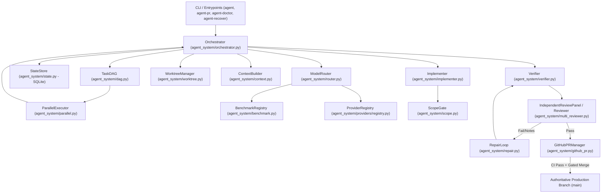

# Multi-Agent Coder — Architecture Specification

## 1. System Overview

Multi-Agent Coder is an autonomous, reliable multi-agent coding orchestrator designed for deterministic, policy-governed software development. The system enforces strict isolation, bounded repair, independent multi-agent review, deterministic verification, and automated GitHub PR integration leading to authoritative merges on `main`.

---

## 2. Core Architectural Layers

### 2.1 Entry Points & Diagnostics
- **`agent`** ([agent_system/cli.py](file:///home/hend/Desktop/multi-agent-coder/agent_system/cli.py)): Command-line interface for running tasks, viewing task status, and inspecting state.
- **`agent-doctor`** ([agent_system/doctor.py](file:///home/hend/Desktop/multi-agent-coder/agent_system/doctor.py)): Comprehensive pre-flight system diagnostics verifying binaries (`git`, `gh`), model configurations, routing validity, and state integrity.
- **`agent-pr`** ([agent_system/github_pr.py](file:///home/hend/Desktop/multi-agent-coder/agent_system/github_pr.py)): Pull request creation, verification gate inspection, and guarded auto-merge manager.
- **`agent-recover`** ([agent_system/recovery.py](file:///home/hend/Desktop/multi-agent-coder/agent_system/recovery.py)): Reconciliation tool for interrupted runs, crash recovery, and orphaned worktrees.

### 2.2 Task Lifecycle & State Store
- **`StateStore`** ([agent_system/state.py](file:///home/hend/Desktop/multi-agent-coder/agent_system/state.py)): SQLite persistent database located by default at `.agent-system/state.db`. Manages atomic transactions, task records, repair attempts, and status transitions.
- **`RuntimeLock`** ([agent_system/runtime_lock.py](file:///home/hend/Desktop/multi-agent-coder/agent_system/runtime_lock.py)): Prevents concurrent processes from stepping on task states or mutating the same worktrees.

### 2.3 Provider Subsystem & Model Routing
- **`ProviderRegistry`** ([agent_system/providers/registry.py](file:///home/hend/Desktop/multi-agent-coder/agent_system/providers/registry.py)): Registry loading providers defined in `config/models.yaml`.
- **`ModelRouter`** ([agent_system/router.py](file:///home/hend/Desktop/multi-agent-coder/agent_system/router.py)): Maps task risk tier (`low`, `medium`, `high`, `critical`) to candidate providers defined in `config/routing.yaml`. Enforces benchmark admission status, dropping `REJECTED` models.
- **`BenchmarkRegistry`** ([agent_system/benchmark.py](file:///home/hend/Desktop/multi-agent-coder/agent_system/benchmark.py)): Evaluates models across deterministic benchmarks, tagging them as `UNBENCHMARKED`, `CANDIDATE`, `VALIDATED`, or `REJECTED` based on consecutive pass rates.

### 2.4 Isolation & Scope Containment
- **`WorktreeManager`** ([agent_system/worktree.py](file:///home/hend/Desktop/multi-agent-coder/agent_system/worktree.py)): Creates isolated temporary git worktrees (`.agent-worktrees/`) for task execution, preventing accidental mutation of the primary working repository.
- **`ScopeGate`** ([agent_system/scope.py](file:///home/hend/Desktop/multi-agent-coder/agent_system/scope.py)):
  - Enforces workspace path containment (rejecting parent escapes).
  - Blocks symlink traversal pointing outside the worktree.
  - Verifies whitespace hygiene (`git diff --check`).
  - Protects the original repository baseline so pre-existing untracked files are never attributed to task errors.

### 2.5 Verification & Review Subsystems
- **`Verifier`** ([agent_system/verifier.py](file:///home/hend/Desktop/multi-agent-coder/agent_system/verifier.py)): Deterministically executes project test commands. Strict zero-tolerance for shell injection: uses argv-based `subprocess.run` without `shell=True`. Deterministic failures unconditionally override AI verdicts.
- **`IndependentReviewPanel`** ([agent_system/multi_reviewer.py](file:///home/hend/Desktop/multi-agent-coder/agent_system/multi_reviewer.py)): Orchestrates multi-reviewer panels (e.g. static/deterministic + AI provider) with quorum rules. AI pass cannot finalize critical-risk tasks without human approval.

### 2.6 Bounded Repair Loop
- **`RepairLoop`** ([agent_system/repair.py](file:///home/hend/Desktop/multi-agent-coder/agent_system/repair.py)): Iterative feedback loop handling test/review failures.
  - Creates pre-repair filesystem checkpoints.
  - Formats detailed failure context (`__repair_context__.json`) for the implementer.
  - Enforces strict bounds (`max_free_attempts = 2`, `max_total_repair_rounds = 3`).
  - Automatically restores checkpoints on scope violations or negative progress.

### 2.7 Multi-Task Scheduling & Parallelism
- **`TaskDAG`** ([agent_system/dag.py](file:///home/hend/Desktop/multi-agent-coder/agent_system/dag.py)): Builds a directed acyclic graph of task dependencies, detecting cycles and returning executable stages in topological order.
- **`ParallelExecutor`** ([agent_system/parallel.py](file:///home/hend/Desktop/multi-agent-coder/agent_system/parallel.py)): Concurrently executes independent DAG tasks across dedicated worktrees.

