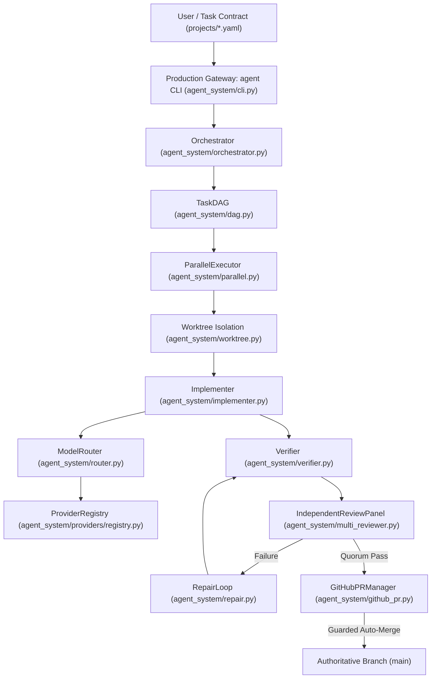

# Multi-Agent Coder — Integration & Reachability Map

## 1. Production Gateway & Reachability Pathways

The primary production gateway is the CLI interface (`agent`), backed by `Orchestrator`. Every component must be connected to this pathway to be considered `PRODUCTION_ACTIVE`.

---

## 2. Upstream & Downstream Component Dependency Matrix

| Component | Upstream Caller (Inputs) | Downstream Dependencies (Outputs) | Reachability from Gateway |
|---|---|---|---|
| `cli.py` | User CLI invocations | `Orchestrator`, `Doctor`, `SystemRecovery` | **Direct Gateway** |
| `orchestrator.py` | `cli.py`, `parallel.py` | `StateStore`, `TaskDAG`, `Implementer`, `Verifier`, `Reviewer`, `RepairLoop` | **Direct Gateway** |
| `dag.py` | `orchestrator.py`, `parallel.py` | None (pure graph algorithm) | **Connected** |
| `parallel.py` | `cli.py`, `orchestrator.py` | `Orchestrator`, `WorktreeManager`, `StateStore` | **Connected** |
| `state.py` | `orchestrator.py`, `parallel.py`, `github_pr.py`, `recovery.py` | SQLite DB (`.agent-system/state.db`) | **Connected** |
| `context.py` | `implementer.py`, `repair.py` | Filesystem, `ScopeGate` | **Connected** |
| `implementer.py` | `orchestrator.py` | `ModelRouter`, `ProviderRegistry`, `ScopeGate`, `WorktreeManager` | **Connected** |
| `router.py` | `implementer.py`, `repair.py` | `ProviderRegistry`, `BenchmarkRegistry`, `config/routing.yaml` | **Connected** |
| `providers/registry.py` | `router.py`, `cli.py` | Provider implementations (`base.py`, `codex.py`, `ollama.py`, `mock.py`) | **Connected** |
| `scope.py` | `implementer.py`, `verifier.py`, `repair.py` | Git CLI, filesystem | **Connected** |
| `verifier.py` | `orchestrator.py`, `repair.py` | `ScopeGate`, `subprocess.run` (argv-based) | **Connected** |
| `reviewer.py` / `multi_reviewer.py` | `orchestrator.py`, `repair.py` | `ProviderReviewer`, `Verifier`, `ScopeGate` | **Connected** |
| `repair.py` | `orchestrator.py` | `ModelRouter`, `Verifier`, `Reviewer`, `ScopeGate` | **Connected** |
| `benchmark.py` | `cli.py`, `router.py` | `ProviderRegistry`, `benchmarks.db` | **Connected** |
| `github_pr.py` | `cli.py`, CI automation | `gh` CLI, Git CLI, `StateStore` | **Direct Sub-Gateway** |
| `doctor.py` | `cli.py`, CI workflows | `ProviderRegistry`, `ModelRouter`, `StateStore`, System Binaries | **Direct Sub-Gateway** |
| `recovery.py` | `cli.py`, Error recovery | `StateStore`, `WorktreeManager` | **Direct Sub-Gateway** |

---

## 3. Disconnected, Shadow, and Experimental Assets

| Asset Path | Nature | Disposition | Reason / Blocker |
|---|---|---|---|
| `agent_system/providers/mock.py` | Mock test provider | `KEEP_SHADOW` | Enabled only during testing; disabled in production `config/models.yaml` by design. |
| `agent_system/providers/codex.py` | Codex CLI provider (`codex-real`, `codex-reviewer`) | `KEEP_SHADOW` / Experimental | Configured as `EXPERIMENTAL`; requires live external API quota/tokens. |
| `agent_system/providers/ollama.py` | Ollama local implementer & reviewer | `DEFER_WITH_BLOCKER` | Configured as `EXPERIMENTAL`; local Ollama daemon & live acceptance tests required to validate. |
| `origin/chore/github-toolkit` | Remote branch (commit `77c5b53`) | `DEFER_WITH_BLOCKER` | Contains complete GitHub CI templates, CodeQL, security scanning, and Dependabot; unmerged to `main`. |
| `projects/demo.yaml`, `example.yaml` | Project templates | `COMPLETE_REUSABLE` | Configuration templates for user onboarding; point to placeholder paths. |
